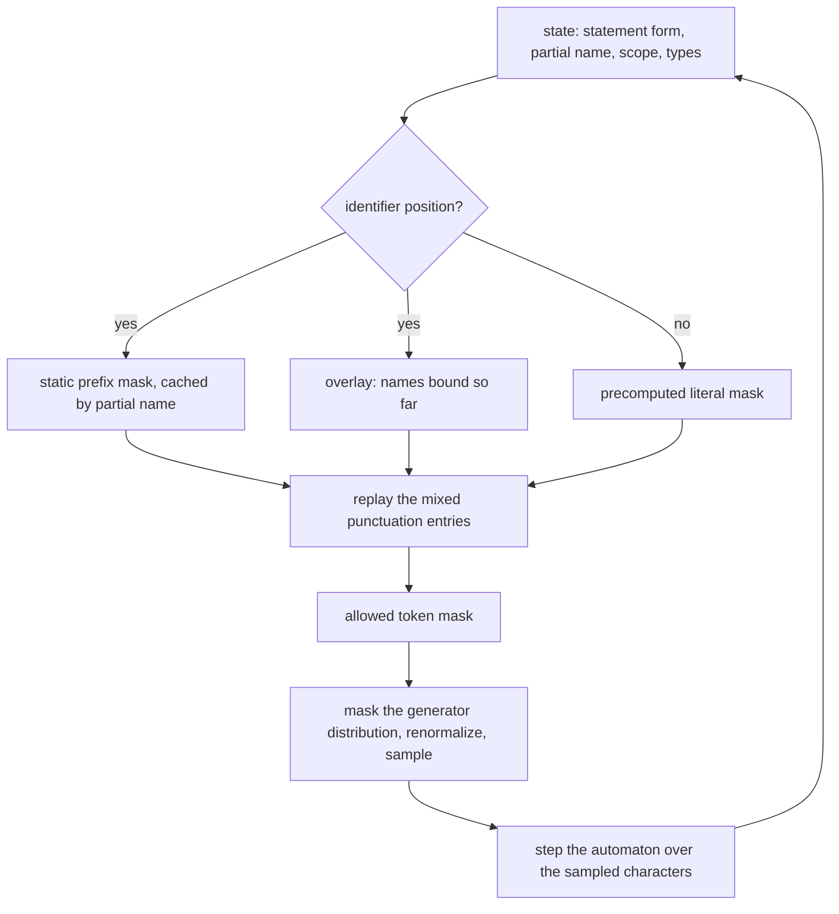
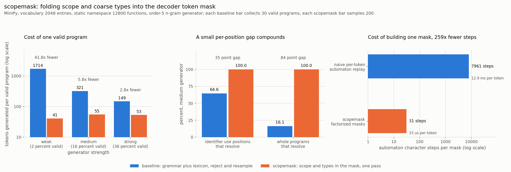

# scopemask

Scope-aware and type-aware constrained decoding: fold name resolution into the
decoder token mask, so generated code cannot reference a variable that is not in
scope or call a method the receiver does not have.

## The problem

Grammar-constrained decoding is now standard. Outlines, XGrammar and llama.cpp GBNF
all compile a grammar into a per-step token mask, and they guarantee that whatever
the model emits will parse. They guarantee nothing about whether the identifiers in
it mean anything.

So a model completing a function emits syntactically perfect Python that reads a
variable which was never bound, calls a helper that does not exist in this project,
or calls `.upper()` on a list. Syntax was never the interesting failure. Name
resolution is.

The usual repair is generate, check, discard, generate again. That is rejection
sampling against a whole-program predicate, and it is the wrong tool, because the
accept rate decays geometrically in the number of identifier use positions. A
generator that is right 90 percent of the time at each of 9 use positions produces a
valid program 39 percent of the time, and every rejected attempt is paid for in full,
at full token cost, before anyone finds out it was wrong.

## What this is

A complete, runnable implementation of the idea that the scope environment belongs
inside the mask, plus the measurements to show what that buys.

- **MiniPy**, a small but real subset of Python, and a character-level automaton for
  it that tracks three things at once: which statement form we are in, which names are
  bound at this point, and the coarse type of each bound name.
- **Three masking modes** over the same automaton, which are the three arms of the
  experiment: grammar only, grammar plus a flat project lexicon, and grammar plus
  scope plus coarse types.
- **A factorized mask builder** that makes the scope-aware mask cheap enough to run at
  every decoding step.
- **A benchmark** that samples programs from a local generator and reports what it
  actually costs to obtain one valid program in each arm.
- **Two independent graders.** The character automaton decides legality during
  decoding. A separate resolver, written over Python's own `ast` module with no shared
  code path, decides it again afterwards. The benchmark fails loudly if they ever
  disagree, so no claim here rests on the constraint engine grading its own homework.

## Why it is interesting

**It constrains meaning, not just shape.** Grammar constraints are a property of the
token stream. Scope is a property of the program being built, and it changes with
every statement. Carrying a live scope environment through the mask is a different
kind of constraint, and at the subword level it is not obvious: a legal name is spelled
across several tokens, so the mask has to answer "is there any in-scope name whose
spelling continues with this token", not "is this token an in-scope name".

**The factorization is what makes it affordable.** The obvious implementation replays
every vocabulary entry through the automaton at every step, which costs thousands of
automaton steps per token. scopemask splits the vocabulary once into the identifier-only
half and the punctuation half. The identifier half is large, and its legality depends
only on the legal-name set, so it is answered by a prefix-keyed mask cache over the
static namespace (which never changes for the whole run) plus a short walk over the
handful of names currently in local scope. The punctuation half is small enough to
replay directly. Measured on this vocabulary, that is **259 times fewer automaton
character steps per mask**, with both builders asserted to return identical masks.

**It measures the cost that is usually hidden.** "Is the constrained output valid" is
a trivial yes. The number that matters is how many tokens you burn to get one valid
program, counting the rejected attempts, and how that gap narrows as the generator
gets better. It narrows, but it does not close.

## Architecture

FigJam board: <https://www.figma.com/board/0RuSO7mE4iEHHBxv2i4wyr>

The diagram shows one decoding step: the generator proposes a distribution, the mask
builder assembles the allowed set from a cached static prefix mask plus a dynamic
overlay of locally bound names plus a replay of the small punctuation half of the
vocabulary, the two are combined and renormalized, and the sampled token advances the
automaton, which may bind a new name and change the mask for the next step.

The same loop as a code-level sketch:



## Results



The metric is **tokens generated per valid program**: every token the generator emits,
including the tokens spent on attempts that were thrown away, divided by the number of
programs that actually resolve. The baseline is grammar-constrained decoding with
identifiers restricted to a flat project lexicon, so every attempt parses and every
identifier is a real name from somewhere in the project. It is then checked, and if it
reads a name that is not in scope here, calls something not callable, or uses a method
the receiver type does not have, it is discarded and resampled. scopemask runs the same
generator with scope and coarse types in the mask, and never retries.

Measured on 2,968 sampled programs, each graded twice:

| generator | baseline valid rate | baseline tokens per valid | scopemask tokens per valid | ratio |
| --- | --- | --- | --- | --- |
| weak | 2.3 percent (30 valid in 1,298 attempts) | 1,714.4 | 41.0 | 41.8x |
| medium | 16.1 percent (30 valid in 186 attempts) | 321.4 | 55.0 | 5.8x |
| strong | 35.7 percent (30 valid in 84 attempts) | 148.8 | 53.4 | 2.8x |

"Generator strength" is the weight on an in-context n-gram fitted online to the program
being written, which is the copying behaviour that keeps real models mostly in scope.
No component of the generator ever sees the legal-name set, so the baseline is never
quietly handed the answer. A stronger generator narrows the gap, as it should, and does
not close it: at the strongest setting the baseline still throws away roughly two of
every three programs it writes.

The middle panel is the reason. At the medium setting the baseline resolves 64.6 percent
of identifier use positions, which is not a disaster, but only 16.1 percent of whole
programs. A program is valid only if every use position in it is, so a 35 point gap per
identifier becomes an 84 point gap per program. (The errors are correlated, so the
program rate is higher than a naive independence estimate would predict.) Rejection
sampling pays the whole program for any single mistake, which is why it loses ground
here. scopemask sits at 0 unresolved use positions and 100 percent valid programs, by
construction rather than by luck.

Two further numbers, both from the same run:

- **Grammar only**, with no lexicon at all, which is what an off-the-shelf
  grammar-constrained decoder gives you: **5 valid programs in 800 attempts**, 0.6
  percent, with 57.5 percent of use positions unresolved. The lexicon baseline in the
  chart is deliberately the more generous comparison.
- **Mask construction**, right panel: the naive builder replays the vocabulary and costs
  **7,961 automaton character steps per decoded token**. The factorized builder costs
  **30.7 automaton steps plus 5.7 vocabulary lookups**, which is 259 times fewer steps,
  and 392 times less wall time (12.9 ms against 32.9 microseconds per token). Both
  builders are pure Python and share one automaton, so the step count is the number to
  trust; the wall clock is a Python-to-Python comparison.

The two graders never disagreed once across all 2,968 programs. The benchmark raises an
error if they ever do.

## How to run it

```bash
git clone https://github.com/joelvarun/scopemask.git
cd scopemask
python -m pip install -r requirements.txt
```

Side by side demo, three tasks completed with and without scope in the mask, plus a
look at what the two masks admit at the same decoder state:

```bash
python examples/demo.py
```

Reproduce the numbers above and rewrite `docs/results.json`. This samples close
to 3,000 programs and grades each of them twice, so it takes several minutes:

```bash
python bench/run_benchmark.py
```

Redraw `docs/before_after.png` from the results file:

```bash
python bench/make_chart.py
```

A quick pass, for checking the wiring rather than reproducing the table:

```bash
python bench/run_benchmark.py --programs 25 --target-valid 5 --max-attempts 200 \
    --syntax-programs 50 --naive-budget 40
python bench/make_chart.py
```

Tests, including the assertion that the factorized and naive maskers return identical
masks on every reachable state in all three modes:

```bash
python -m pytest tests/ -q
```

## Example output

From `python examples/demo.py`. Same header, same generator, same seed, same number of
tokens, one difference:

```
task: complete this function. Parameter types: seg is dict, value is num, width is list

before, grammar plus project lexicon: 51 tokens
def pack_weight_meta(seg, value, width):
    value = value.values()
    _metample = pack_weight_meta(seg)
    _metample = pack_weight(mark)
    _metample = pack_weight(mark)
    returnpack_weight = pack_weight(mark)
    return pack_weight_meta
  verdict: rejected, no attribute values

after, scopemask: 56 tokens
def pack_weight_meta(seg, value, width):
    value = value.conjugate()
    returnconjugatehint = pack_weight_meta(seg)
    returnconjugatehint = patch_field_safe(seg)
    returnconjugatehint = pack_weight(seg)
    returnconjugatehint = pack_weight_meta(seg)
    return patch_field_safe
  verdict: resolves (every name is in scope, every method exists)
```

Both parse. The first one calls `.values()` on a number and reads `mark`, which was
never bound. The second one reaches for `.conjugate()` because `value` is a number, and
every argument it passes is a name that exists at that point in the program. Neither is
good code, because the generator is an n-gram; the difference is that only one of them
means anything.

The demo closes by comparing the masks at a single state:

```
Widest gap between the two masks in that program, at the start of a name,
with locals acc, row, val:
  grammar plus lexicon admits 1582 of 2048 vocabulary entries
  scopemask admits 1504, removing 78 (4.9 percent) that cannot continue a name
```

That is the shape of the result in one line. The mask barely moves at any single step,
and the entries it removes are precisely the ones the generator gets wrong.

## Repository layout

```
scopemask/
  minipy.py      the language, and the character automaton for syntax, scope, types
  masker.py      NaiveMasker and FastMasker, asserted to agree on every state
  tokenizer.py   byte-pair tokenizer, so identifiers span several entries
  lm.py          order-5 backoff n-gram plus an online in-context n-gram
  corpus.py      the static namespace and the training corpus
  decode.py      the three decoding arms
  validate.py    the independent ast resolver and the per-use-position audit
bench/
  run_benchmark.py   measures everything, writes docs/results.json
  make_chart.py      draws docs/before_after.png from that file
examples/demo.py
tests/
docs/
```

## The language

MiniPy is a real subset of Python: everything generated here is accepted by
`ast.parse`. A program is a function header with three typed parameters, up to five
body statements, and a return. The statement forms are

```
name = atom op atom          # op is one of + - *, atom is a name or a small integer
name = receiver.method()     # method must exist for the coarse type of the receiver
name = callable(atom)        # callable must be a module level function or a builtin
return name                  # name must be in scope
```

Coarse types are `list`, `str`, `dict` and `num`. Parameter types come from the header;
in a real setting they would come from annotations or from inference. The static
namespace is 12,800 module level functions with known return types, which stands in for
a project's importable surface, and the 48 short local names stand in for the identifiers
a model is likely to reach for.

## Honest limitations

- **The generator is not a language model.** It is an order-5 backoff n-gram mixed with
  an online in-context n-gram. It was chosen because it reproduces the failure mode
  under study, fluent syntax with wrong names, on a CPU in ten seconds. Absolute
  tokens-per-valid figures depend on generator quality, which is exactly why three
  strengths are reported instead of one. The mechanism transfers to any source of
  logits; the numbers are specific to this generator.
- **MiniPy has no control flow, no nesting and no closures.** Real scope tracking has to
  handle comprehension scopes, globals, imports and shadowing across blocks. The
  automaton here is deliberately small enough to be read in one sitting.
- **The vocabulary is 98.6 percent identifier-only** because MiniPy has few punctuation
  forms. A production tokenizer has a lower identifier share, and the speedup from the
  factorization scales with that share, so 259x is an upper end for this setting rather
  than a number to quote elsewhere.
- **The static prefix cache is filled lazily during decoding**, so the timing above is
  steady state. The cache is keyed on the partial identifier, which is why it is worth
  keeping: the static namespace is the same for every program in the run.
- **Type inference is coarse and local.** There is no flow analysis, no generics and no
  user-defined classes.

## License

MIT. See [LICENSE](LICENSE).
